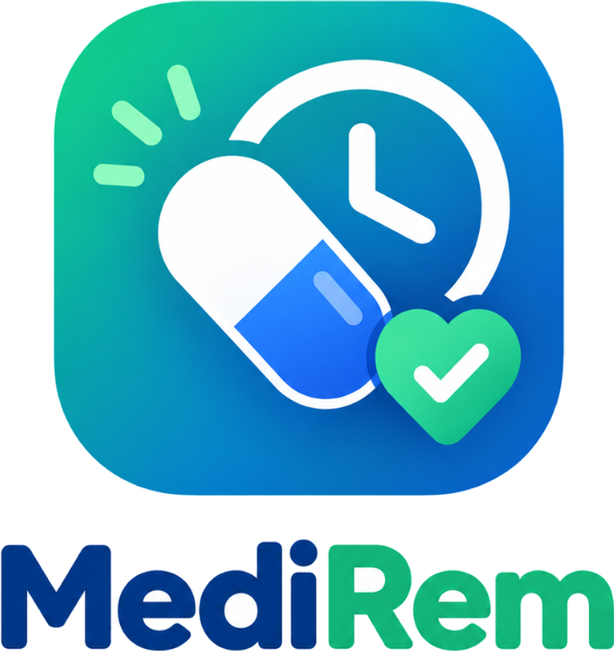

# MediRem 💊 - Smart Medication Reminder & Routine Tracker

A modern, high-precision medication reminder and inventory management mobile application built with **React Native**, **Expo SDK 58**, **Expo Router**, and **NativeWind (Tailwind CSS)**.



---

## 🌟 Key Features

### ⏰ 1-Minute Continuous Medical Alarm
- **Continuous 60s Chime:** High-priority, uncompressed 44.1kHz harmonic alarm sound plays continuously through the device speaker without cutting off prematurely.
- **Rhythmic Device Vibration:** Multi-beat physical vibration repeats synchronously with the audio chime.
- **Bypasses Silent Mode:** Configured with `playsInSilentMode: true` and exclusive audio focus so alarms sound aloud even when the phone is set to silent or vibrate.

### 🔁 Persistent 3-Minute Repeat Cycle
- **Unattended Safety Repeat:** If an alarm rings for 1 minute and is not acknowledged, audio pauses and arms an automatic **3-minute snooze timer**.
- When the 3 minutes elapse, the alarm rings again for another full 1 minute.
- **Permanent Stop Controls:** Clear in-app options allow stopping the alarm permanently so it never rings again after 3 minutes for that dose once taken.

### 📦 Smart Pill Supply & Auto-Calculated Inventory
- **Real-Time Remaining Counter:** Displays exact pill count (e.g. `30 / 30 pills (100%)`) with dynamic progress bar and color-coded status badges.
- **Auto-Sync Duration:** Creating a 7-day routine automatically calculates and defaults supply to `7 pills`; 14 days $\rightarrow$ `14 pills`; 30 days $\rightarrow$ `30 pills`.
- **One-Tap Actions:**
  - `Take Dose (-1)`: Decrements supply and marks dose as taken.
  - `[-]` and `[+]` quick stepper: Adjusts counts instantly.
  - `Refill`: Resets supply back to 100% capacity.
  - `Sync to Routine`: 1-tap correction to match pill count with remaining routine days.

### 📅 Calendar & Clock Time Pickers
- **Custom Interactive Calendar:** Visual monthly date selector for start and end dates with presets (7 Days, 14 Days, 30 Days, Ongoing).
- **Time Slot & Clock Selector:** Morning, Afternoon, Evening, Night slots with custom 12-hour AM/PM time selector.

### 📸 Medication Photo Upload
- Take a live picture or choose from the photo gallery to visually verify pill shape, color, and packaging on the reminder cards.

---

## 🛠 Monorepo Tech Stack (Powered by Turborepo)

- **Monorepo Engine:** [Turborepo 2](https://turbo.build/)
- **Workspaces:** `apps/*` and `packages/*`
- **Shared Types:** `@medirem/types` in `packages/types`
- **Shared Config:** `@medirem/typescript-config` in `packages/typescript-config`

### 📱 Frontend (`apps/mobile`)
- **Framework:** [React Native 0.88](https://reactnative.dev/) & [Expo SDK 58](https://expo.dev/)
- **Navigation:** [Expo Router ~58.0.27](https://docs.expo.dev/router/introduction/) (File-based routing)
- **Styling:** [NativeWind v4](https://www.nativewind.dev/) (Tailwind CSS)
- **Audio & Haptics:** [`expo-audio ~58.0.10`](https://docs.expo.dev/versions/latest/sdk/audio/) & `react-native Vibration`
- **Notifications:** [`expo-notifications ~58.1.6`](https://docs.expo.dev/versions/latest/sdk/notifications/)
- **Camera & Gallery:** [`expo-image-picker ~58.0.10`](https://docs.expo.dev/versions/latest/sdk/image-picker/)
- **AI Chatbot:** Built-in interactive MediRem AI assistant (`apps/mobile/src/app/(tabs)/chat.tsx`)

### 🚀 Backend (`apps/backend`)
- **Framework:** [NestJS 10](https://nestjs.com/) (TypeScript)
- **ORM & Database:** [Prisma ORM 5](https://www.prisma.io/) with SQLite (configurable to PostgreSQL)
- **Validation:** `class-validator` & `class-transformer`
- **Architecture:** Modular architecture with `MedicationsModule`, `DosesModule`, `HealthModule`, and `PrismaModule`

---

## 🚀 Getting Started

### Prerequisites
- Node.js (v18 or higher)
- npm (v9 or higher, with npm workspaces support)
- Expo Go app on Android or iOS, or a physical device connected via USB

### Installation

```bash
# 1. Clone repository
git clone https://github.com/MD-Kayesur/MediRem_app_react-native.git
cd MediRem_app_react-native

# 2. Install monorepo dependencies
npm install

# 3. Build shared packages & apps via Turborepo
npm run build

# 4. Initialize Prisma database
npm run prisma:migrate
npm run prisma:generate

# 5. Run both mobile and backend in parallel with Turborepo
npm run dev

# Or run separately:
npm run mobile          # Expo dev server
npm run backend:dev     # NestJS dev server
```

Scan the QR code with **Expo Go** (Android) or the Camera app (iOS) to launch the app instantly.

---

## 📁 Turborepo Monorepo Structure

```
MediRem/
├── turbo.json                  # Turborepo task pipeline configuration
├── package.json                # Root package.json with workspaces & turbo scripts
├── packages/
│   ├── types/                  # Shared TypeScript types & DTOs (@medirem/types)
│   └── typescript-config/      # Shared tsconfig bases (@medirem/typescript-config)
├── apps/
│   ├── mobile/                 # Expo React Native mobile application (@medirem/mobile)
│   │   ├── src/
│   │   │   ├── app/            # Expo Router screens (today, meds, chat, history, profile)
│   │   │   ├── components/     # UI widgets & DateTime pickers
│   │   │   ├── services/       # Audio, notifications & API services
│   │   │   └── global.css      # Tailwind CSS
│   │   ├── assets/             # App icons, splash screens, sounds
│   │   ├── app.json            # Expo configuration
│   │   └── package.json
│   │
│   └── backend/                # NestJS + Prisma ORM REST API (@medirem/backend)
│       ├── src/
│       │   ├── medications/    # Medications CRUD & dose recording
│       │   ├── doses/          # Dose history & compliance logs
│       │   ├── health/         # Health check API (/api/health)
│       │   ├── prisma/         # Prisma service & connection
│       │   ├── app.module.ts   # Root NestJS module
│       │   └── main.ts         # NestJS entry point (port 3000)
│       ├── prisma/
│       │   └── schema.prisma   # Prisma database schema
│       └── package.json
```

---

## 📄 License

This project is open source and available under the [MIT License](LICENSE).
